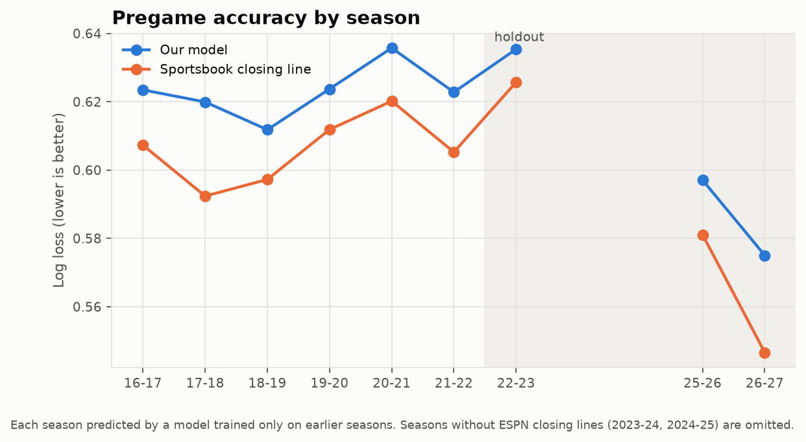
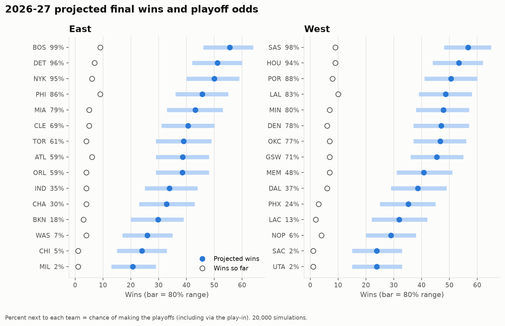
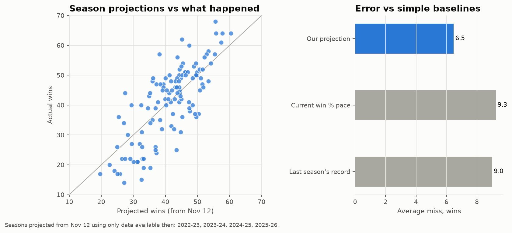
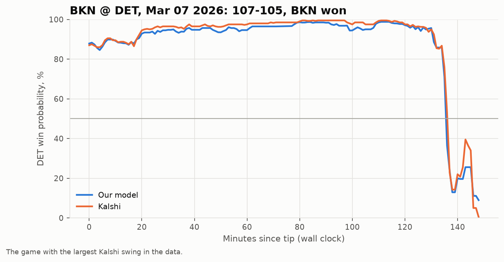

<div align="center">

# NBA Prediction Engine

**Win probabilities for every NBA game, scored against Kalshi and the sportsbooks.**

A Python engine that predicts NBA games before tip and during play, projects the season,
and tests whether any of it beats Kalshi's prediction-market prices after fees.

</div>

<!--- Language and data --->
<p align="center"><sub><b>Language & Data:</b></sub></p>
<p align="center">
  
  
  
  
  
</p>

<!--- Tooling and status --->
<p align="center"><sub><b>Tooling & Status:</b></sub></p>
<p align="center">
  
  
  
</p>

## What it is

The engine estimates a fair win probability for each game from basketball data alone, then
compares it with the price on Kalshi's `KXNBAGAME` markets. The aim was to strip crowd
sentiment out of the market price and trade the gap.

The design idea is that player value comes from who was actually on the floor together. The
engine rebuilds 482,701 five-on-five lineup stints from play-by-play and rates players on
those, so a team's strength moves when its stars sit. Everything is tested walk-forward:
each season is predicted by a model that only saw earlier seasons.

The honest result so far: the model is well calibrated and close to the market, but Kalshi
is sharper. No strategy has beaten Kalshi after fees, so nothing trades. The full write-up
is in [reports/BRIEF.md](reports/BRIEF.md).

<table>
  <tr>
    <td width="50%"></td>
    <td width="50%"></td>
  </tr>
  <tr>
    <td width="50%"></td>
    <td width="50%"></td>
  </tr>
</table>

## Results

| | Our model | Market |
|---|---|---|
| Pregame log loss, unseen seasons 2022-23 on (lower is better) | 0.6155 | 0.6020 (closing line) |
| Winners picked, same games | 66.4% | 67.2% |
| Winners picked, 2026-27 so far (159 games) | 68.6% | 71.1% (Kalshi pre-tip) |
| In-game log loss at the same moments | 0.443 | 0.434 (Kalshi live) |
| Season projections, average miss from Nov 12 | 6.5 wins | 9.0 to 9.3 for naive baselines |

Calibration slope is 1.02 (1.00 is perfect). The best pregame signal beats Kalshi's tip-off
price by about half a cent, and Kalshi's taker fee is about 1.5 cents.

## How it works

- **Pregame model:** lineup-stint player ratings, pace-adjusted team efficiency, Elo, and
  rest, travel and altitude. A ridge model and a small numpy tree model are averaged into a
  predicted margin, which becomes a win probability.
- **In-game model:** a fitted random-walk model using score, time left, possession and
  pregame strength.
- **Forecasts:** next-7-day game probabilities with injured players removed, and a 20,000-run
  simulation of the rest of the season through the playoffs.
- **Market side:** Kalshi REST and WebSocket clients, a fee model, and an order-book recorder.

## Run it

Requires Python 3.12 and [uv](https://docs.astral.sh/uv/).

```bash
uv sync
uv run nba-engine backfill espn      # games, box scores, closing lines since 2014-15 (~1.5h)
uv run nba-engine backfill kalshi    # settled Kalshi markets and minute candles (~25 min)
uv run nba-engine build-pbp          # play-by-play and lineup stints (~10 min)
uv run nba-engine train              # walk-forward model and report
uv run nba-engine predict            # next 7 days, model vs Kalshi
uv run nba-engine project            # rest-of-season simulation
uv run nba-engine figures            # charts in reports/figures/
```

`uv run nba-engine --help` lists every command, including `tune`, `backtest`, `ingame`,
`validate-projections` and the live `record` command. Tests run with
`uv run python -m pytest -m "not network"`.

## Docs

- [reports/BRIEF.md](reports/BRIEF.md): results summary with every chart
- [reports/phase1_pregame.md](reports/phase1_pregame.md): pregame model vs the market, by season
- [reports/phase2_pregame_backtest.md](reports/phase2_pregame_backtest.md): pregame trading backtest
- [reports/phase3_ingame.md](reports/phase3_ingame.md): in-game model and Kalshi live prices
- [reports/FINDINGS.md](reports/FINDINGS.md): what failed and why
- [docs/PLAN.md](docs/PLAN.md): the original build plan and phase status
