# NBA Prediction Engine: overnight brief

_November 12, 2026. Every number below is out of sample unless marked otherwise._

## What was built

- **Data:** 15,638 NBA games since 2014-15, with full box scores, closing lines and 7.3M
  play-by-play events. 482,701 five-on-five lineup stints were rebuilt from the
  play-by-play, with valid lineups for 98.6% of game time. Kalshi data covers 1,683 settled
  games (3,366 team markets), with 7.6M minute candles.
- **Pregame model v2:**
  - Player ratings from lineup stints, shrunk toward a box-score prior.
  - Pace-adjusted offense/defense ratings, Elo and decayed margin ratings.
  - Rest, travel and altitude.
  - A ridge model and a small gradient-boosted tree model averaged together.
  - Settings tuned on 2016-17 to 2021-22 only; 2022-23 onward is a true holdout.
- **In-game model:** a fitted random-walk win-probability model (score, time, possession,
  pregame strength), trained on 2016-17 to 2021-22 play-by-play.
- **Forecasts:** next-7-day game probabilities that remove injured players using ESPN's
  injury report. A 20,000-run simulation of the rest of 2026-27 covering standings,
  play-in, playoffs and the title.

## Headline results

| Question | Answer |
|---|---|
| How accurate is the pregame model on unseen seasons? | Log loss **0.6155** vs the sportsbook close's 0.6020 (2022-23 on, 2,545 games). It picks the winner **66.4%** of the time vs 67.2%. |
| How much did v2 improve on v1? | The gap to the closing line shrank from +0.019 to **+0.016** over all seasons. |
| This season so far (159 games) | It picked **68.6%** of winners. Kalshi's pre-tip price picked 71.1% and the sportsbook close 71.7%. |
| Is it calibrated? | Yes: slope 1.02 (1.00 is perfect). |
| Season projections, backtested from Nov 12 | Average miss of **6.5 wins**, vs 9.3 for "current pace" and 9.0 for "last season". It got **77.5%** of playoff/no-playoff calls right. |
| In-game model | Log loss **0.454** vs 0.485 for the textbook formula. Kalshi's live price is sharper still (0.434 vs 0.443). |
| Is there a tradeable edge? | **No.** Every pregame and in-game strategy loses after fees. |

## 1. Pregame accuracy

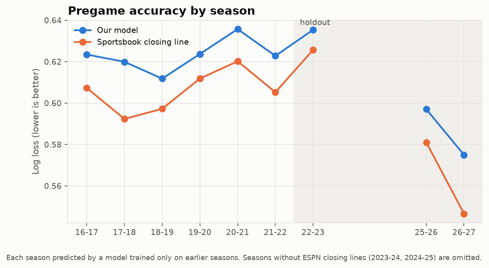

The model trails the closing line by about 0.013-0.017 log loss every season. That's a
consistent, modest gap: the market prices injury news, minutes restrictions and sharp money
earlier and better than box scores can. The gap was smaller in the holdout (+0.0135) than in
the tuning seasons (+0.0174), so the tuning didn't overfit.

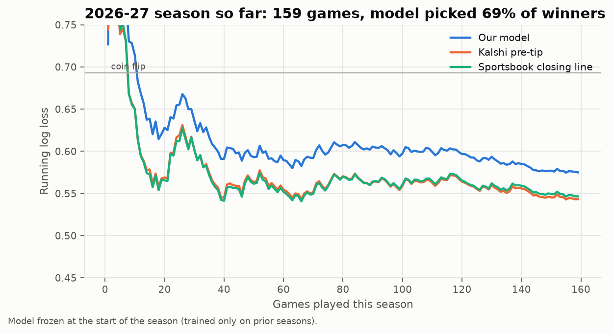

The model went into 2026-27 trained only on earlier seasons. Its ratings updated game by
game; its weights did not. Kalshi and the books have stayed about 0.03 log loss ahead all
season. That's wider than the long-run gap, as expected for the first few weeks, when
summer roster changes make every rating less certain.

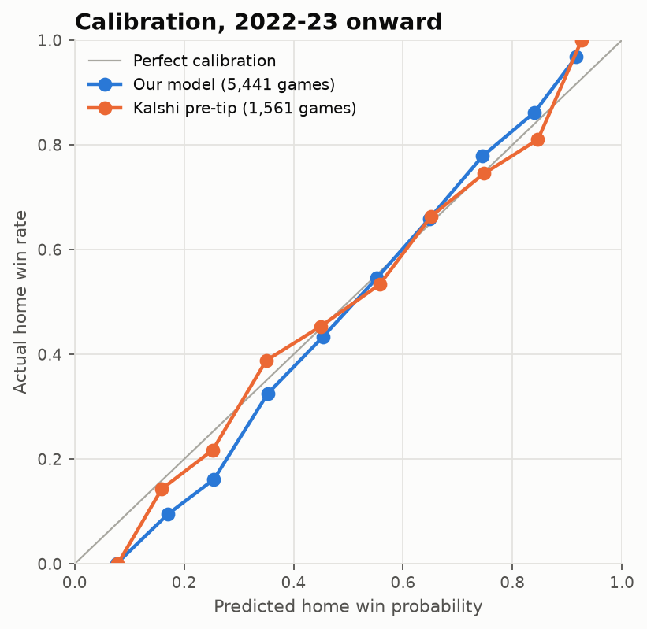

## 2. What drives a prediction

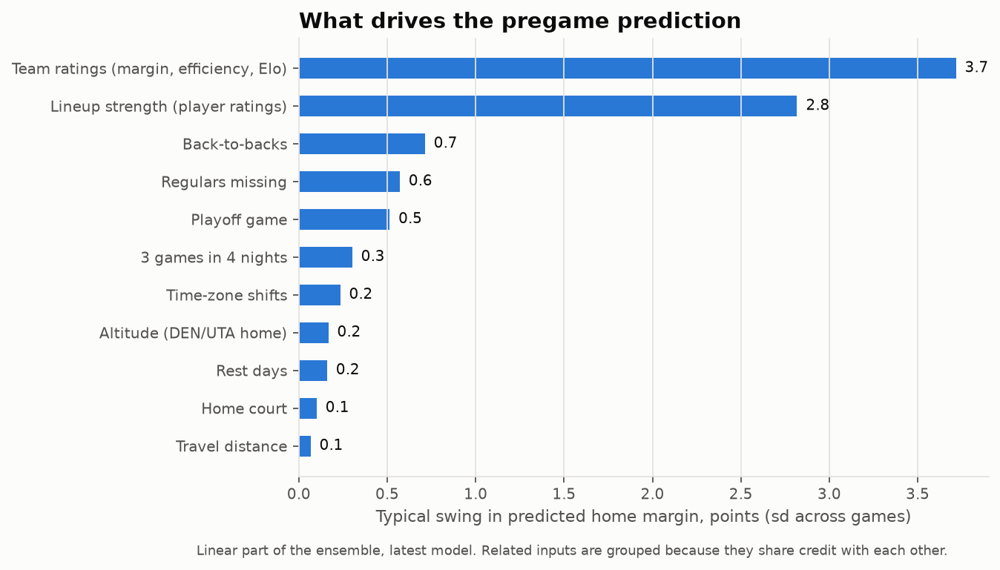

Team ratings and lineup strength do almost all the work. Back-to-backs and missing
regulars matter at the margin. Travel and time zones barely register once rest is known.

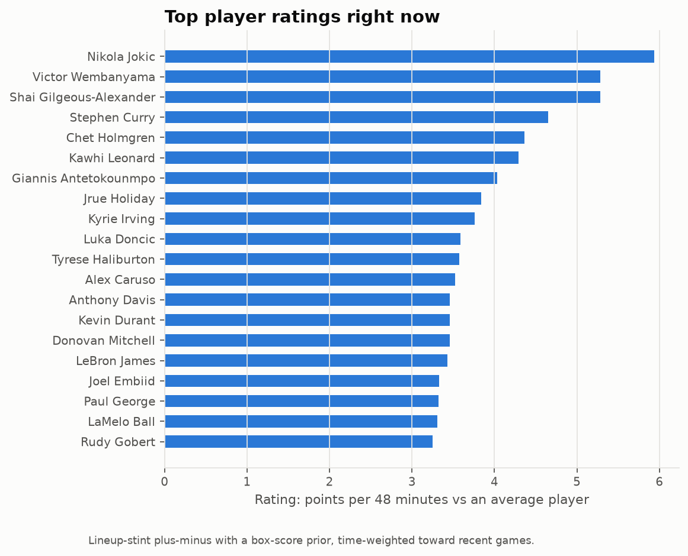

These ratings come from who was actually on the floor together, so a strong bench player on
a great team doesn't inherit his starters' plus-minus.

## 3. Upcoming games (next 7 days)

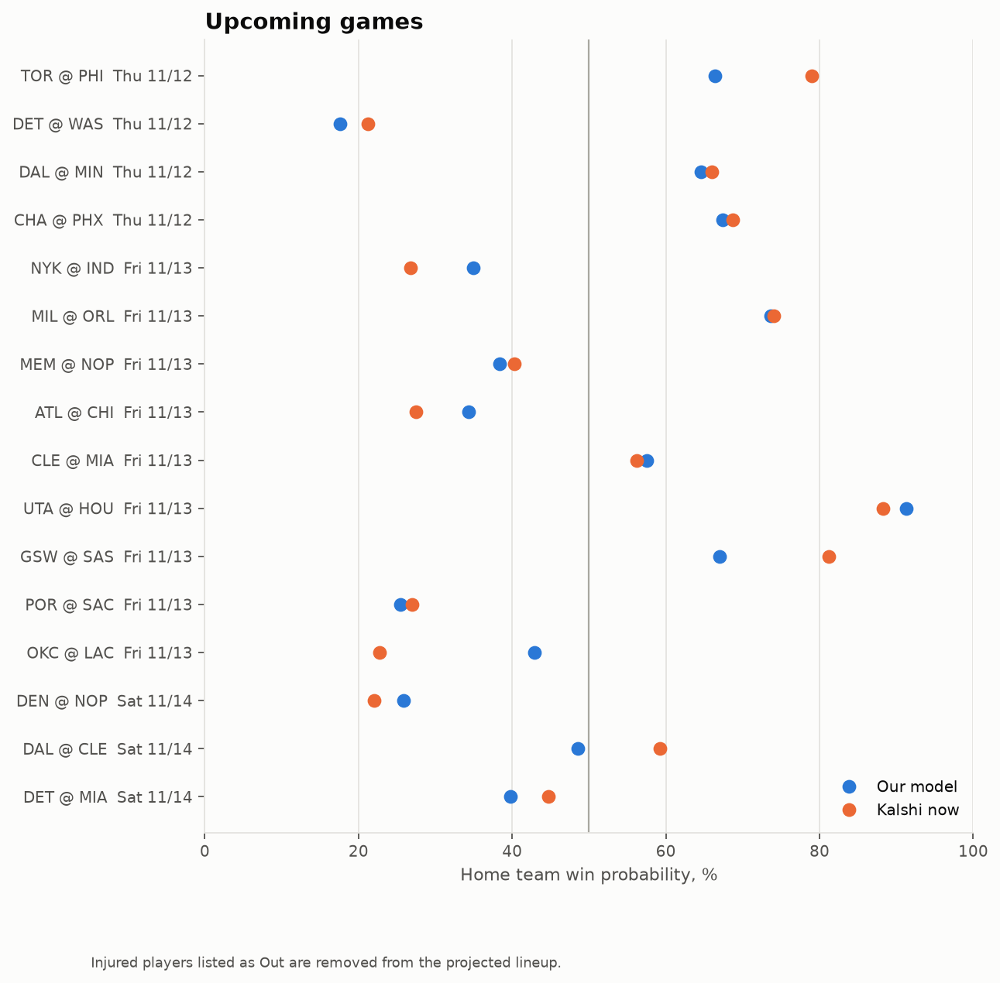

[The full table](predictions/upcoming.csv) lists each game's predicted margin and win
probability, Kalshi's current price, and the injured players removed from each side. The
model and Kalshi differ by **5.2 points of probability** on average.

The largest disagreements are OKC @ LAC (model 43% LAC, Kalshi 23%) and GSW @ SAS (67% vs
81%). Given the backtests, a large gap more likely means Kalshi knows something the injury
feed doesn't yet than that Kalshi is wrong.

## 4. The rest of 2026-27

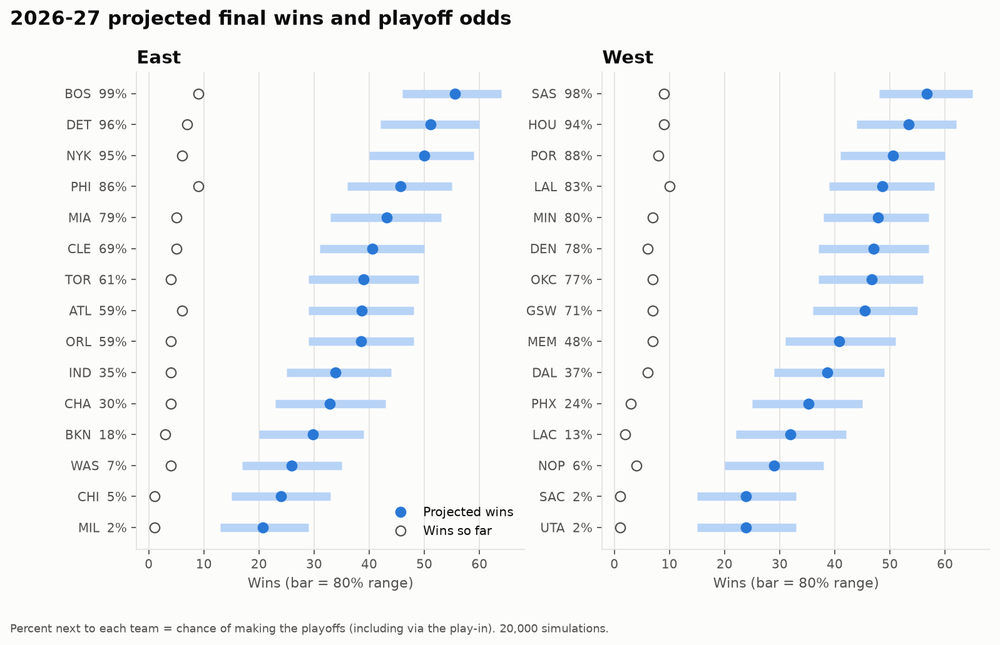

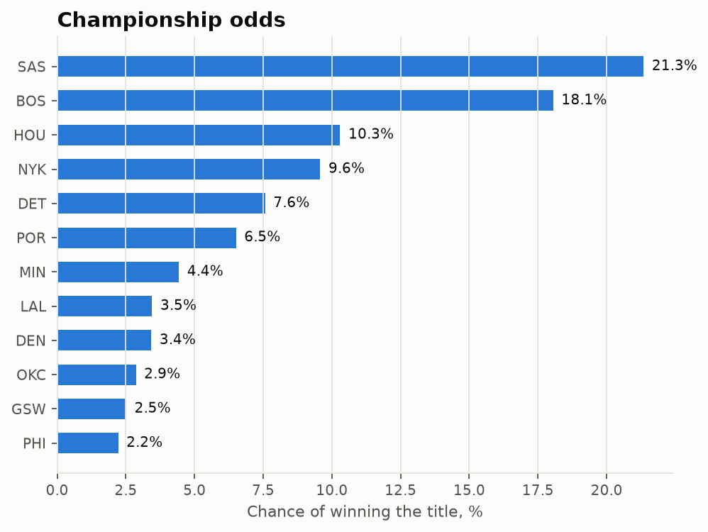

| | East | West |
|---|---|---|
| Top projected records | BOS 55.5 W, DET 51.2, NYK 50.0, PHI 45.7 | SAS 56.6 W, HOU 53.4, POR 50.6, LAL 48.6 |
| Title favorites | BOS 18.1% | SAS 21.3%, HOU 10.3% |

Full table: [season_projection.csv](predictions/season_projection.csv) (projected wins, 80%
range, playoff, play-in, #1 seed, conference finals, finals and title odds).

**Is it any good?** Each of the last four seasons was projected from November 12 using
only data available then:

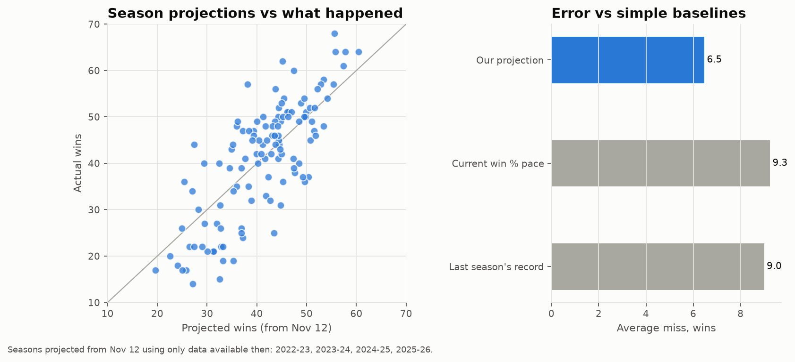

- The 80% win ranges captured exactly 80% of final records. The size of the season-long
  strength uncertainty was calibrated on these same four seasons, so treat the coverage as
  in-sample.
- Playoff-odds Brier score is 0.160, vs 0.249 for a no-information guess (lower is better).

**Later seasons:** 2027-28 can't be forecast meaningfully yet, because the draft, free
agency and trades decide too much. The same code will project it from opening night once
rosters are set.

## 5. In-game win probability

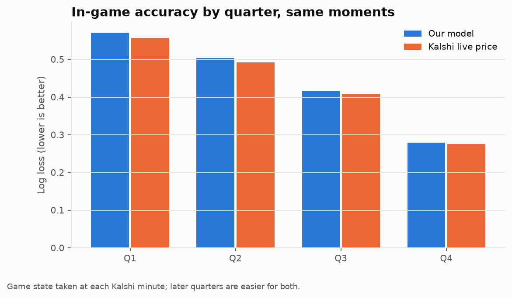

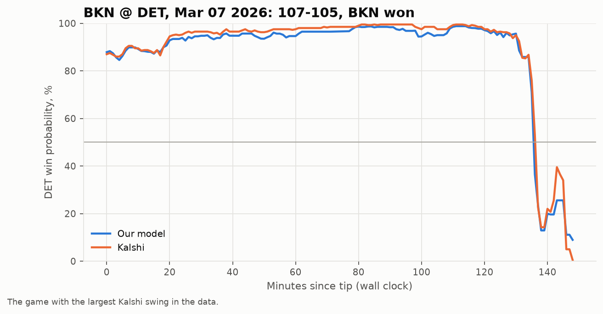

Our in-game model is well calibrated: each bin's actual win rate is within about one point
of the prediction ([chart](figures/ingame_calibration.png)). Kalshi's live price is still
more accurate at the same moments, because traders watch the game in real time while our
free ESPN feed runs about 25+ seconds behind.

## 6. Trading verdict

- **Pregame:**
  - No combination of model, sportsbook line and bias correction beat Kalshi's own price
    at any horizon from 24 hours to 15 minutes.
  - The best signal is model-only entries at a 5-point edge. They beat the tip price by
    **+0.46¢** on average (90% CI 0.18 to 0.73¢). That's real but too small: taker fees
    are ~1.5¢, and holding to settlement returned -2.3% (CI spans zero).
- **In-game:** fading swings at dead balls with a 30-second feed delay lost 8-10% at every
  threshold. Kalshi moved toward the model by under 1¢ while positions were held.
- **Status:** no strategy passes its gate, so nothing should trade. Details are in
  [phase2](phase2_pregame_backtest.md) and [phase3](phase3_ingame.md).

## Caveats

- **Backtest availability is slightly optimistic.** Backtests take player availability from
  box scores, which include late scratches. Live forecasts use ESPN's injury report, so live
  accuracy will be a little worse.
- **Two seasons lack closing lines.** ESPN has none for 2023-24 and 2024-25, so those
  seasons are missing from the market comparisons.
- **Pure-numpy gradient boosting.** Windows Smart App Control blocks scikit-learn's compiled
  libraries on this machine, so the tree model is a small numpy implementation.

## What would move accuracy next

1. **Timestamped intraday odds** (paid). This is the only way to test whether Kalshi lags
   sharp books during the day.
2. **A minutes-projection model.** Right now expected minutes are a simple recent average;
   coaches' rotations and minutes restrictions are where the market still beats us.
3. **A Kalshi API key for the recorder.** Real order-book depth would make any future
   execution backtest honest.

## Reproduce

```bash
uv run nba-engine backfill espn && uv run nba-engine backfill kalshi
uv run nba-engine build-pbp && uv run nba-engine tune
uv run nba-engine train && uv run nba-engine backtest && uv run nba-engine ingame
uv run nba-engine validate-projections && uv run nba-engine project && uv run nba-engine predict
uv run nba-engine figures
```
